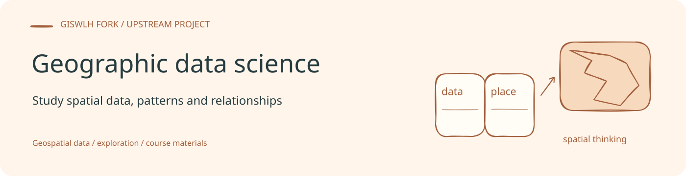
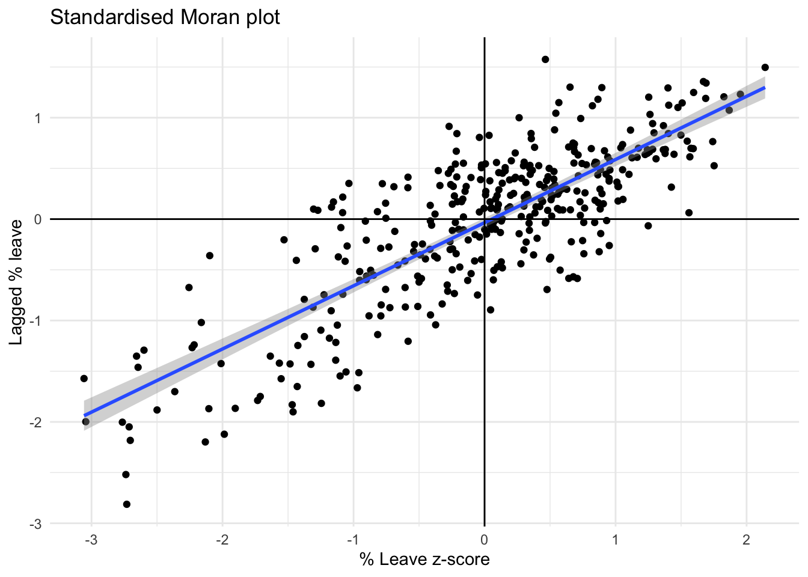

# Geographic Data Science 课程资料

本仓库是 [pietrostefani/gds](https://github.com/pietrostefani/gds) 的 fork，保存利物浦大学 Geographic Data Science 课程 ENVS363/563 的 Quarto 教材与练习。课程由 Dr. Elisabetta Pietrostefani 与 Dr. Carmen Cabrera-Arnau 编写和讲授。

**阅读原课程：[Geographic Data Science](https://pietrostefani.github.io/gds/)。** 本页提供仓库导航，课程作者及原始内容归属保持不变。

## 学习内容

- R 环境与开放科学工作方式。
- 空间数据、矢量制图与栅格制图。
- 空间权重、探索性空间数据分析和聚类。
- 点模式与空间网络分析。

许多章节包含说明文件、`*_code.qmd` 代码材料和 `*DIY.qmd` 练习。当前书籍配置以 R 环境章节为主；仓库也包含部分 Python 教学材料。

## 文件入口

| 路径 | 内容 |
| --- | --- |
| [index.qmd](index.qmd) | 课程介绍、作者与许可声明 |
| [_quarto.yml](_quarto.yml) | 书籍章节、格式和输出目录 |
| [syllabus.qmd](syllabus.qmd) | 课程大纲 |
| [overview.qmd](overview.qmd) | 课程目标与学习要求 |
| [environR.qmd](environR.qmd) | R 环境准备 |
| [datasets.qmd](datasets.qmd) | 数据集说明 |
| [data](data) | 随课程保存的数据 |
| [docs](docs) | 已有的网站输出 |

## 预览

在具备 Quarto 与章节所需 R/Python 环境后，可从仓库根目录预览：

```bash
quarto preview
```

构建书籍使用 `quarto render`；配置将输出写入 `docs/`。具体包与数据要求应先查看环境准备章节及对应练习，渲染含代码的章节可能执行其计算。

## 来源与许可

原课程说明其内容采用 [CC BY-NC-ND 4.0](https://creativecommons.org/licenses/by-nc-nd/4.0/)，详见 [index.qmd](index.qmd)。课程还注明部分材料受 Dani Arribas-Bel 的 Geographic Data Science 课程启发。复用内容时应保留这些署名和原有许可说明。

本仓库首页横幅的可编辑源文件：[banner.excalidraw](assets/readme/banner.excalidraw)。


<!-- readme-visual-refresh:selected-result -->

## 已有结果展示



原课程 ESDA 章节生成的标准化 Moran 散点图，展示 Leave 比例与空间滞后变量的关系。 该图为仓库已有上游示例，保留原有来源；本次仅整理展示，未重新运行。 [查看来源](https://github.com/GISWLH/gds_course/blob/main/docs/esda_code_files/figure-html/unnamed-chunk-17-1.png)。

<!-- /readme-visual-refresh:selected-result -->
